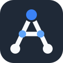

# Academy Kit

Turn a set of documents into a private learning website, an **academy**, and keep it on your own computer.

You point Claude at a folder of documents (a handbook, design notes, policies, a repo's docs). You get a small website with one lesson per topic, written in plain words, that you read in your browser.

## What a reader gets

- **Lessons** with a "plain words" note under every part, a worked example, the rules that are easy to get wrong, key terms and a quiz. Progress is remembered.
- **Translate**: select a word and get it in your own language, in the context of that sentence. Without a second language it becomes **Explain** (simpler words).
- **Visualize**: select a paragraph and see it as boxes and arrows.
- **Mind map**: select a term, or click an underlined code like `R12`, and see every place the lessons use it, grouped by idea. Each point links back to its sentence.
- **Ask**: ask a question about a selection or a term. The answer uses only the lesson text and shows its sources.
- **Listen**: press the speaker beside a paragraph, or Listen on a part's heading, and it is read to you by a natural voice. Pause, speed and voice are in a small bar.
- Optional: a short narrated **video** per lesson, and a **sync** check that tells you when the documents changed and which lessons are affected.

Translate, Visualize, Mind map and Ask use a model that runs on your computer (through [Ollama](https://ollama.com)). Listen uses a voice model that also runs on your computer. Your documents are not sent anywhere.

## The idea: the tool and the content are separate

| | Where | Who owns it |
|---|---|---|
| **The kit** | this repository | shared; the same for everyone |
| **An academy** | a folder of your own: `academy.json` + `content/*.json` | you; it holds your lessons and nothing of the kit |

So you can share the kit freely and keep each academy wherever its documents belong.

## What is public and what is private

| | Public: this repository | Private: your academy |
|---|---|---|
| What | The tool: scripts, the website code, the skill, the guides, a small example made from the kit's own guides. | Everything made from your documents: settings, lessons, the built site, videos, a clone of your documents, a brand font. |
| Where | Here. | A folder of your own, outside this repository, kept as confidential as the documents. |

A lesson restates its source, so an academy is as sensitive as the documents it was made from. The kit helps you keep the two apart:

- `init.py` and `build.py` refuse an academy that sits inside the kit.
- Every new academy gets a `PRIVATE.md` that says where it may and may not go.
- `tools/check_public.py` fails if this repository contains an academy, a built site, media, documents, fonts, a password or token, an e-mail address, a home-folder path, or any word on your own private list. Run it before you publish, and turn it on for every commit:

```bash
git config core.hooksPath .githooks
```

Your private list (company, project and host names that must never appear here) lives on your computer in `~/.config/academy-kit/private-words.txt`, one per line. It is not part of the repository.

## Install

You need Python 3.9 or newer (already on a Mac) and [Claude Code](https://claude.com/claude-code) or the Claude desktop app.

```bash
./install.sh
```

This links the `academy` skill into `~/.claude/skills`. The repository is also laid out as a Claude Code plugin (`.claude-plugin/plugin.json`), if your team installs skills that way.

For the AI features, install Ollama and one model:

```bash
ollama pull gemma4:e4b
```

Any Ollama chat model works; set the names in the academy's `academy.json` (`ai.models`). Small models (4–8 GB) are enough.

## Make an academy

In a new Claude session, say what you want:

> Make an academy from the docs in `~/work/library-handbook`. I read English but my own language is German.

Claude reads the documents, proposes a lesson plan for you to approve, writes the lessons, builds the site and opens it. Later: "add a lesson about X", "the handbook changed, update the academy", "make the videos".

## Or by hand

```bash
python3 skills/academy/engine/init.py ~/work/library-academy --title "Library Academy" --docs ~/work/library-handbook --reader German
```

Write lessons into `content/` (format: [LESSON_BRIEF.md](skills/academy/references/LESSON_BRIEF.md)), then:

```bash
python3 skills/academy/engine/build.py ~/work/library-academy
```

```bash
python3 skills/academy/engine/serve.py ~/work/library-academy --open
```

To see a finished one first:

```bash
python3 skills/academy/engine/build.py skills/academy/example && python3 skills/academy/engine/serve.py skills/academy/example --open
```

## What is in here

| Path | What |
|---|---|
| `skills/academy/SKILL.md` | What Claude follows to make and maintain an academy. |
| `skills/academy/engine/` | `init`, `validate`, `build`, `serve`, `sync` (Python, no packages), the website (`portal/`), the video renderer (`video/`), an always-on Docker setup (`docker/`). |
| `skills/academy/references/` | [Lesson format](skills/academy/references/LESSON_BRIEF.md), [settings](skills/academy/references/CONFIG.md), [listen](skills/academy/references/LISTEN.md), [videos](skills/academy/references/VIDEO.md), [sync](skills/academy/references/SYNC.md). |
| `skills/academy/example/` | A small academy that teaches the kit itself. The only academy allowed in here. |
| `tools/check_public.py`, `.githooks/`, `.github/workflows/` | The check that keeps private things out, as a script, a commit hook and a CI job. |
| `THIRD_PARTY_NOTICES.md` | What is bundled (Mermaid) and what is not. |
| `LICENSE` | MIT. |

## Good to know

- **Private by design.** The site is served on `localhost` only. The lessons, the documents and your questions stay on your machine.
- **The model is small and local.** Its diagrams and "by idea" groupings can be loose. Every mind-map point links to the real sentence, so you can check.
- **Lessons are written by an AI from your documents.** They are told to state only what the documents say, but skim a lesson against its source before relying on it for a decision.
- **Listen** needs a natural voice on your computer: the kit's own (a one-time setup, see [LISTEN.md](skills/academy/references/LISTEN.md)) or a high-quality system voice. Robotic voices are not used.
- **Videos** need extra tools and speak English (and a few other languages, not German). An academy is complete without them.
- **Look.** Colors and font can be set per academy (`theme` and `font` in `academy.json`). The kit ships no fonts.

## License

[MIT](LICENSE). The kit bundles Mermaid, which is also MIT; see [THIRD_PARTY_NOTICES.md](THIRD_PARTY_NOTICES.md).

The licence covers the kit. An academy you build with it is yours and stays private.
